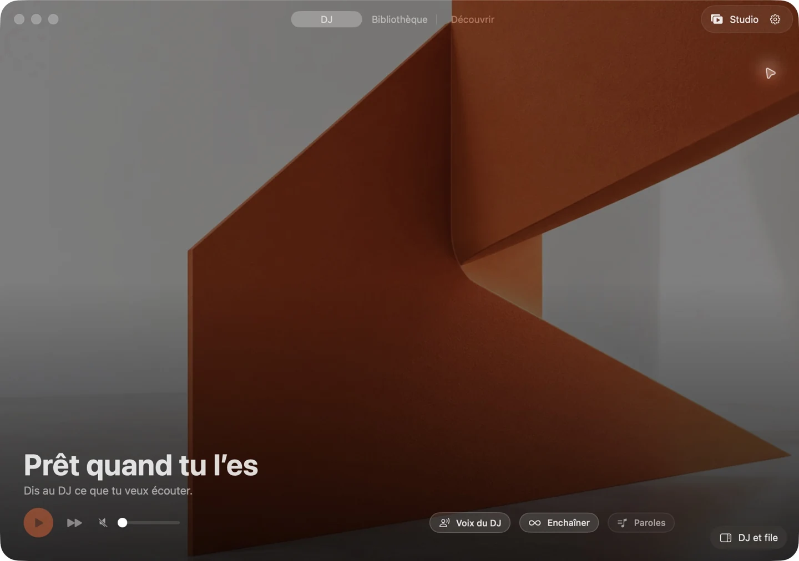

# Sillage — by Stoa

Bibliothèque musicale, recherche et DJ conversationnel sur Mac.



Sillage rassemble un lecteur natif macOS, une bibliothèque de playlists YouTube,
la recherche et un DJ qui peut utiliser Gemini ou Claude avec votre propre clé API.
Le serveur utilise le Vercel AI SDK. La voix macOS fonctionne sans clé Google supplémentaire.

## État du projet

Première publication du code. Le build Mac de préparation est 1.8.1 (72).
Le projet reste en développement : pas de binaire public signé Developer ID et notarisé,
pas d’installateur universel en un clic, ni d’accès hébergé ouvert garanti.
Le serveur et le client contiennent encore des origines Stoa à adapter pour un déploiement autonome.
Voir [les limites de distribution](docs/distribution.md) avant de commencer.

## Prérequis

- macOS 14 ou plus récent pour le client natif ; Xcode 26 ou plus récent pour compiler l’interface (SDK 26), même si la cible d’exécution reste macOS 14+.
- Node.js 24 et npm pour le serveur et l’extension.
- PostgreSQL et les variables de `.env.example` pour le serveur.
- Un projet Google OAuth / YouTube configuré pour votre propre déploiement.
- Une clé Gemini ou Claude, enregistrée depuis les réglages de votre compte.

## Développement

```sh
npm ci --legacy-peer-deps
npm run verify:node
npm run test:macos
```

Pour compiler l’application :

```sh
MAC_SIGNING_IDENTITY=- npm run build:macos -- --dmg --skip-update-signature
```

Le DMG local est marqué aperçu. `--public-release` exige un certificat Developer ID et les outils Apple, signe les composants imbriqués, fait notariser l’app et le DMG et contrôle Gatekeeper avant d’émettre le manifeste. Sans validation Apple, aucun téléchargement public sans avertissement n’est annoncé.
Pour essayer une build de développement sans la session de votre app habituelle,
lancez-la avec un `RECALL_DATA_DIR` temporaire et un identifiant de bundle QA distinct.

## Documentation

- [Architecture](docs/architecture.md)
- [Distribution et auto-hébergement](docs/distribution.md)
- [API](docs/api.md)
- [Données de compte](docs/account-data.md)
- [Contribuer](CONTRIBUTING.md)
- [Sécurité](SECURITY.md)

## Licence et médias

Le code original est sous [licence MIT](LICENSE). Les dépendances conservent leurs licences.
Les identités Sillage et Stoa ne constituent pas une marque libre sous licence MIT.
Les noms d’artistes et contenus YouTube appartiennent à leurs titulaires ; aucun catalogue
musical, fichier vidéo tiers, clé API ou session utilisateur n’est distribué avec ce dépôt.
