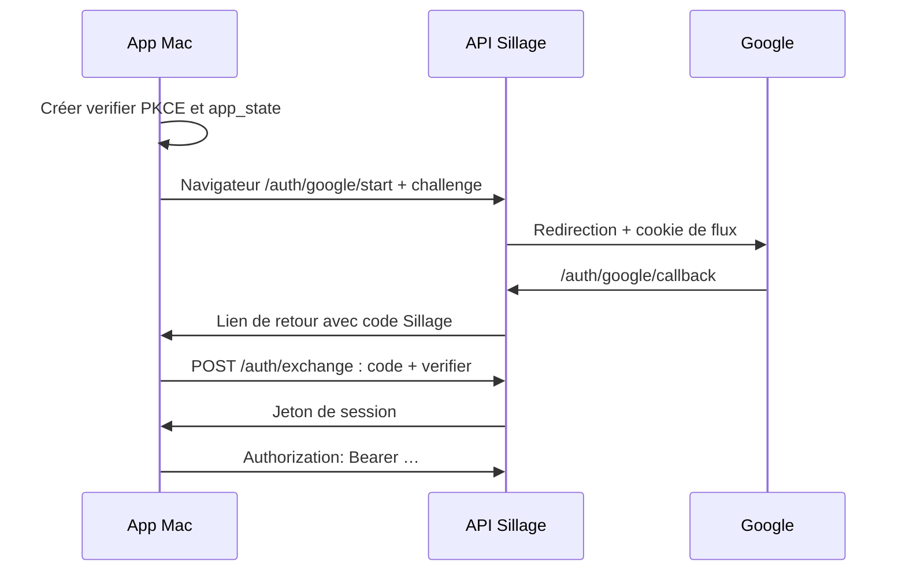

# API développeur Sillage

Cette documentation reste **sur le Mac du développeur**. Aucune route Swagger ou OpenAPI n’est montée dans l’API publique. Les fichiers du dépôt ne contiennent aucune clé Gemini ni session personnelle.

## Démarrage

Depuis la racine du dépôt :

```sh
npm ci --legacy-peer-deps
npm run docs:serve
```

Ouvrir **http://127.0.0.1:3030**. Les ressources Swagger sont installées avec le projet et servies localement, sans CDN ni validation externe. Le processus écoute uniquement `127.0.0.1`.

Par défaut, les essais appellent le serveur Sillage. Pour cibler une API de développement :

```sh
RECALL_DOCS_API_URL=http://127.0.0.1:3001 npm run docs:serve
```

`RECALL_DOCS_PORT` permet de changer le port de documentation. La cible est fixée au lancement ; aucune URL arbitraire n’est acceptée depuis une requête. Le relais local évite de modifier les règles CORS de production. Il transmet uniquement les routes documentées, ne transmet pas les cookies et ne suit pas les redirections. Le flux Google et les ressources du lecteur se consultent directement sur le serveur, pas à travers ce relais.

## Postman sur le Mac

Deux formats dérivés du même contrat :

| Usage | Fichiers |
| --- | --- |
| Postman avec **Local Files / Open Folder** | Ouvrir le dépôt ; `postman/collections/sillage/` contient les requêtes Git natives v3, `postman/environments/` les deux environnements. Aucun workspace cloud n’est lié. |
| Import classique | `postman/exports/Sillage.postman_collection.json`, puis les environnements `Local.postman_environment.json` et `Serveur.postman_environment.json`. |
| Autre outil compatible OpenAPI | `postman/specs/sillage.openapi.json` (OpenAPI 3.1). |

Choisir **Sillage — Local** ou **Sillage — Serveur privé**. `base_url` désigne la cible. `api_token` est le **jeton de session Sillage**, pas une clé Gemini. `gemini_api_key` sert uniquement aux réglages du DJ. Les deux valeurs sont volontairement vides et marquées secrètes dans les environnements fournis. Pour rester local, utiliser les valeurs locales de Postman ou son Vault, jamais une valeur partagée ou un fichier suivi par Git. Le type « secret » masque une valeur ; il ne remplace pas le chiffrement ni l’isolement du stockage choisi.

Un appel de lecture sans compte suffit à vérifier l’installation :

```sh
postman collection run postman/collections/sillage \
  -e 'postman/environments/Serveur privé.environment.yaml' \
  -i getHealth -i getAuthStatus --no-report-events
```

Le même essai fonctionne avec les exports JSON v2.1. Le CLI peut afficher une invitation à se connecter à Postman ; ces essais locaux n’exigent ni publication des résultats ni connexion cloud.

**Choisir les requêtes à exécuter.** La collection contient aussi déconnexion, suppression, transfert de bibliothèque et appels Gemini/YouTube consommant leurs quotas. Un lancement intégral n’est pas une recette de test de production. Les corps utilisent des exemples publics ou des variables à renseigner ; aucune session n’est récupérée automatiquement depuis l’app.

## Connexion Google et séparation des comptes



- Le flux de départ expire après 10 minutes. Son cookie est Secure, HttpOnly et SameSite=Lax.
- Le code Sillage expire après 90 secondes, ne s’utilise qu’une fois et exige le verifier correspondant. Le callback ne se rejoue pas comme une simple requête Postman indépendante.
- La session dure 90 jours et sa durée est prolongée à l’usage lorsqu’il en reste moins de 60. PostgreSQL conserve l’empreinte SHA-256 du jeton. `/v1/logout` révoque la session utilisée.
- Le Mac conserve la connexion dans son fichier privé de session, sans Trousseau. Ces fichiers ne sont pas des exports de développement.
- Le middleware retrouve `userId` à partir du jeton. Les requêtes de bibliothèque, historique et réglages se limitent à ce compte. Les métadonnées publiques des vidéos peuvent être partagées ; les rattachements de playlists et les secrets restent personnels.

Google fournit uniquement **identité, nom et e-mail** (`openid email profile`). Cela n’autorise aucune écriture dans les playlists YouTube. « Mes découvertes » est une collection Sillage privée, pas une playlist créée dans le compte YouTube.

## Clé Gemini

1. `/v1/dj/settings` enregistre `{ apiKey, model }` pour la première activation. Pour changer seulement de modèle, retirer `apiKey` du corps afin de conserver la clé actuelle.
2. La clé est chiffrée côté serveur par AES-256-GCM, avec le compte comme contexte authentifié. La clé de chiffrement serveur reste dans l’environnement privé. Aucune route de lecture ne renvoie la clé Gemini.
3. `/v1/dj/check` teste réellement Google sans enregistrer les paramètres fournis. Lire `ok`, `voice` et `message`, même si HTTP vaut 200.
4. `/v1/dj/settings/reset` supprime les réglages personnels ; les playlists restent présentes.

Swagger **Authorize** demande seulement le jeton Sillage. La clé Gemini se renseigne dans le corps du réglage, jamais dans Authorize ni dans une URL. Swagger ne mémorise pas l’autorisation au rechargement.

## Recherche, DJ et pagination

| Fonction | Contrat |
| --- | --- |
| Bibliothèque | `POST /v1/search` : `offset`, `limit` (1–100), `total`, filtres de playlist, mode texte ou image. Recherche limitée aux appartenances actives du compte. |
| YouTube | `POST /v1/discover/search` : `query` et `pageToken` opaque ; reprendre `nextPageToken`. Cache des résultats publics, propriété `inLibrary` recalculée par compte. |
| DJ | `POST /v1/dj/chat` : `scope=library`, `youtube` ou `all`, contexte de lecture, historique de conversation, exclusions et derniers résultats proposés. |
| Décision du DJ | `replace` lance maintenant, `append` ajoute à la suite, `keep` conserve la lecture ; le Mac exécute cette décision. Le serveur ne contrôle pas directement le lecteur natif. |
| Historique | `GET /v1/history` : 50 événements par défaut, maximum 200. Reprendre `playedAt` et `id` de la dernière ligne dans `before` et `beforeId`. |
| Import | `POST /v1/playlists` accepte un lien public ou non répertorié et retourne 202 avec une tâche. Vérifier ensuite `/v1/status` et `/v1/playlists` ; 202 ne signifie pas import achevé. |
| Métadonnées | `/v1/library/enrichment` distingue correspondance certaine, ambiguïté, absence et erreurs. `processed` ne signifie pas « morceau identifié avec certitude ». |

Le catalogue MCP est exposé sur `/v1/mcp` en Streamable HTTP stateless avec le même Bearer. Utiliser un client MCP ou JSON-RPC (`initialize`, `tools/list`, `tools/call`). Les GET/DELETE documentés rendent 405, pas des opérations métier. Le DJ utilise une connexion MCP en mémoire ; ce transport n’impose pas un détour HTTP à chaque outil.

## Erreurs et effets

- **400** : entrée invalide, format d’identifiant ou curseur incorrect.
- **401** : session absente, expirée ou révoquée ; reprendre la connexion.
- **403** : opération de maintenance non permise ou transfert historique refusé.
- **404** : ressource absente du compte. Cela ne révèle pas les ressources des autres comptes.
- **413** : corps trop gros (30 Mio pour l’API ; 8 Kio pour le sous-ensemble `/auth`).
- **429** : lire le détail ; peut signifier débit Sillage, DJ déjà occupé, budget ou quota d’un fournisseur. Ce n’est pas automatiquement une clé Gemini épuisée.
- **502/503** : source/configuration indisponible. Conserver la lecture et la file lorsque la recherche échoue.
- **200 avec état négatif** : courant pour le test Gemini ou les paroles absentes/indisponibles. Vérifier le contenu métier, pas seulement le code HTTP.

L’API `/v1/*` limite le débit à 180 requêtes/minute/jeton. Les demandes de chat/test DJ sont limitées à une simultanée par compte et deux sur l’instance. Les opérations de maintenance historique ne sont pas des droits d’administrateur attribués à tous les comptes Google.

## Maintenir le contrat

Les contraintes d’entrée réutilisent les validateurs Zod réellement employés par les routes. Les réponses et descriptions sont déclarées dans `apps/server/src/api-docs/`. La génération suit une seule direction : **validateurs + catalogue des opérations → OpenAPI → exports Postman JSON et fichiers Git natifs**.

```sh
npm run docs:generate
npm run docs:check
postman collection lint postman/collections/sillage
postman environment lint postman/environments
postman spec lint postman/specs/sillage.openapi.json --issueType=syntax --no-report-events
npm run verify:node
```

`npm run check` inclut la vérification des fichiers générés. Un test compare les routes Hono montées et les opérations documentées, pour détecter un endpoint ajouté sans contrat. Les tests de documentation vérifient aussi l’absence de routes publiques Swagger, l’authentification, le relais à cible fixe et les restrictions d’origine. Les assertions Postman fournies contrôlent le succès HTTP ; elles ne prouvent pas à elles seules la pertinence d’une réponse DJ ni la lecture effective dans l’app.
