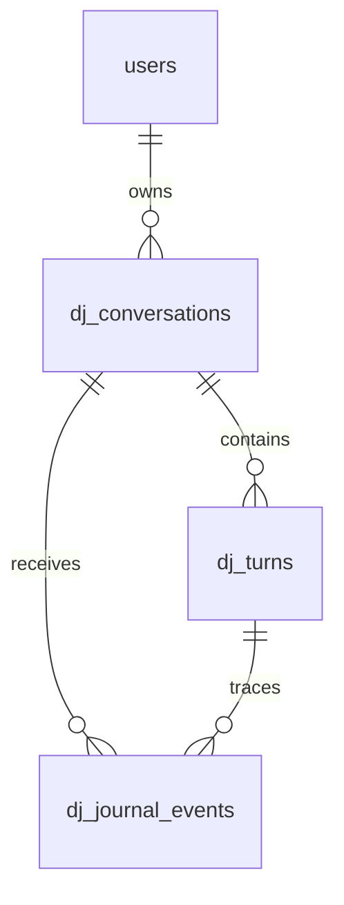

# Journal privé du DJ

Le journal fournit des faits pour reproduire un bug : ce que la personne a demandé, où elle voulait chercher, les outils utilisés, ce qu’ils ont renvoyé, la décision du serveur et ce que l’app a réellement affiché ou mis en file. Il ne modifie ni le prompt, ni le classement, ni la lecture.

## Ce qui est enregistré

- **Conversation** : UUID de session d’écoute et compte propriétaire. Une nouvelle session d’app ou un changement de compte démarre une nouvelle conversation.
- **Tour serveur** : message et historique reçus, contexte du morceau en cours, propositions récentes, exclusions, source explicitement reçue et source effective (`library`, `youtube`, `all`), intention calculée et nombre demandé. Réponse finale intégrale, action (`keep`, `append`, `replace`), morceaux et sources Web ; statut, dates, modèle, empreinte du prompt système et SHA serveur.
- **Événements serveur** : résolution directe du catalogue, réponses visibles du fournisseur, noms/identifiants/arguments des appels d’outils, résultats normalisés, durées, code HTTP fournisseur, consommation de jetons disponible et erreurs de source. Les résultats sont exactement ceux interprétés par l’agent ; une sélection corrigée peut être comparée à la réponse brute du fournisseur.
- **Événements Mac** : demandes et réponses réellement affichées (y compris pause, suivant et annonces locales), propositions avec appartenance à la bibliothèque, source de la demande et source visible au moment de l’événement, morceau en cours et identifiants de la file. Les actions signalent aussi une réponse ignorée, une annulation, une erreur de lecture ou un réordonnancement. `requestId` relie ces événements au tour serveur correspondant.

Les contenus sont conservés **sans anonymisation ni masquage automatique** : noms, titres et formulations restent tels quels. Les clés configurées et les en-têtes Bearer ne sont jamais transmis au module du journal. Les signatures internes du fournisseur et son raisonnement caché ne sont pas collectés. Éviter donc de coller un secret dans un message : le texte de conversation est conservé tel quel.

La voix audio, le son du micro, les vidéos et les pages Web complètes ne sont pas enregistrés dans ces tables. La dictée soumise au DJ est un message texte normal. La consultation `/prompt` n’est pas une conversation avec le DJ.

## Stockage et séparation des comptes

`dj_conversations` possède la clé `(user_id,id)`. Les tours et événements référencent cette même paire. Le propriétaire vient exclusivement du jeton authentifié ; jamais du corps envoyé par l’app. Toutes les lectures, tous les curseurs et l’effacement filtrent sur ce propriétaire. Deux comptes peuvent utiliser le même UUID sans partager une ligne. Un événement client reste `origin=client` : il n’est pas une preuve d’exécution du serveur.

Les conversations et réponses sont du JSON/texte lisible en PostgreSQL, protégés par les accès à la base et au compte. **Ce n’est pas le chiffrement spécifique des clés Gemini** : celles-ci restent dans `account_dj_settings`, avec leur chiffrement existant. Les sauvegardes de la base contiennent aussi le journal et doivent rester privées. Il n’existe pas de jeton développeur global donnant accès aux échanges de tous les comptes ; l’opérateur DB conserve ses accès habituels.

## Parcours développeur

Dans Swagger local ou Postman, ouvrir **Journal DJ** :

1. `GET /v1/dj/conversations?limit=25` liste les conversations du compte.
2. `GET /v1/dj/conversations/{conversationId}/turns` montre sources, intentions finales, statuts et modèle.
3. `GET /v1/dj/turns/{turnId}` donne l’entrée, le résultat et les appels détaillés du serveur.
4. `GET /v1/dj/conversations/{conversationId}/events?after=0&limit=50` permet de reconstruire le chat et les actions locales. `sequence` est un bigint transmis comme chaîne. Utiliser `nextCursor` tel quel ; une valeur nulle termine la page. Pour les conversations/tours, utiliser `before=nextCursor`.
5. `DELETE /v1/dj/conversations/{conversationId}` efface cette conversation et ses traces, sans modifier playlists, historique d’écoute ou clé Gemini. Les sauvegardes expirent selon leur propre rétention.

L’ordre serveur est celui de réception. Après une reconnexion, `occurredAt` et `clientSequence` permettent de replacer les événements du Mac dans leur ordre d’origine. Le temps du Mac n’est pas une horloge serveur de confiance.

## Fiabilité et limites explicites

- Migration additive et idempotente, dans la transaction habituelle. Aucun original musical n’est remplacé. Une ancienne version serveur reste compatible avec la base migrée.
- Le tour est créé avant le traitement. Chaque étape serveur est écrite sans bloquer l’exécution des outils ; la réponse attend la fin des écritures. Une panne de stockage ne transforme pas une réponse musicale en erreur. `journal_complete=false` ou `X-Sillage-Journal: unavailable` signalent une trace partielle. Un arrêt brutal peut laisser un tour `running` ; `stale=true` après cinq minutes le rend visible.
- Le Mac regroupe au plus 50 événements par envoi, avec UUID stables et insertion idempotente. Les échecs sont réessayés avec délai jusqu’à 30 secondes ; le journal n’entraîne aucune nouvelle requête au modèle. Après trois échecs, un message signale la synchronisation en attente.
- Le tampon reste **en mémoire** (1 000 événements maximum), sans nouvelle copie locale persistante. Quitter l’app hors ligne peut perdre les actions locales non envoyées ; les tours déjà reçus par le serveur restent en base. Le dépassement du tampon est signalé. La requête serveur contient aussi le petit historique récent, mais ne permet pas de reconstituer tous les clics hors ligne.
- Les limites des contenus suivent les contrats existants : message DJ 1 500 caractères, historique modèle de 12 messages, journal client 8 192 caractères par message, 8 cartes, 5 sources et 100 identifiants de file au maximum. Le chat peut effacer ses anciens messages en mémoire sans effacer les événements déjà envoyés. Le journal ne restaure pas encore automatiquement le chat au redémarrage.
- Un payload serveur supérieur à 256 Kio est explicitement marqué `truncated` avec taille, empreinte et aperçu, plutôt que silencieusement coupé. Au plus 64 étapes par tour ; au-delà, le journal est marqué incomplet. Les échanges courants restent intégraux sous ces limites.
- Collecte dès cette version, sans récupération possible des conversations antérieures perdues. Pas de purge automatique ni d’entraînement automatique sur ces données. L’amélioration du DJ se fait ensuite par analyse et scénarios de régression explicitement choisis.

## Validation

Les tests couvrent les écritures PostgreSQL et une seconde migration, l’isolation de deux comptes (même UUID inclus), les réessais, la pagination, l’effacement, les erreurs de DJ, les contenus verbatim et l’absence de collecte de la clé de configuration ou des signatures du fournisseur. Un scénario exécute la boucle d’agent et les vrais outils MCP avec les seules frontières externes simulées ; il vérifie l’ordre catalogue → fournisseur → outil → fournisseur. Le cœur Swift vérifie les sources, la corrélation, les événements affichés, les accusés de réception, les limites mémoire et le changement de compte.
