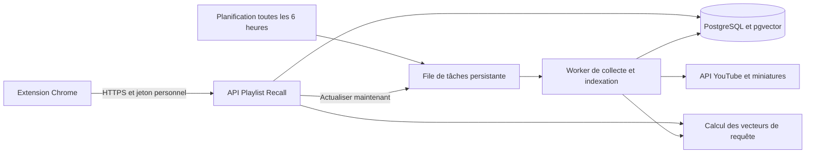

# Playlist Recall — synchronisation serveur et recherche enrichie

Date : 7 octobre 2026. Statut : approuvée par Samuel le 7 octobre 2026 ; développement et déploiement autorisés.

## Besoin et périmètre

Samuel utilise déjà l’extension et veut retrouver les nouvelles vidéos de ses playlists, avec davantage de contexte pour la recherche. Il souhaite utiliser le VPS qui héberge Stoa, stocker les playlists en base, les synchroniser automatiquement et enrichir la vectorisation avec descriptions et images. Il a confirmé que les playlists sont publiques ou non répertoriées.

La proposition vise un usage personnel : un propriétaire, plusieurs playlists et éventuellement plusieurs installations de l’extension. Les playlists privées et la connexion Google ne sont pas nécessaires. La bibliothèque personnelle et les liens non répertoriés restent accessibles uniquement au propriétaire.

Livrable visé : extension connectée à une API privée, synchronisation durable, index textuel enrichi et index visuel de miniatures. La base locale actuelle reste disponible comme repli explicite. Aucun déploiement ni changement applicatif n’a été effectué pendant cette étude.

## État constaté

- Dépôt existant : `playlist-recall`, branche `codex/local-playlist-recall`, arbre propre avant ce document.
- Extension WXT / React / TypeScript ; IndexedDB ; modèle E5 multilingue local de 384 dimensions ; recherche lexicale et sémantique fusionnée par rang.
- Export personnel embarqué : 2 818 entrées, 2 792 vidéos uniques, 2 666 vecteurs. Zéro description et des tags pour une seule vidéo. Ce décompte ne représente pas la playlist YouTube actuelle.
- Le document sémantique actuel coupe la description à 1 000 caractères : enrichir la collecte sans revoir cette préparation limiterait le gain.
- VPS contrôlé en lecture seule : 4 processeurs logiques, 5 921 Mio de RAM, 2 860 Mio disponibles lors du contrôle, 331 Gio libres sur le disque racine. Cette mesure ponctuelle n’est pas une garantie de capacité en charge. Aucune capacité GPU n’a été vérifiée.
- Stoa, le mail, les analytics et la newsletter partagent déjà cette machine. PostgreSQL de Stoa est une ressource indépendante. Playlist Recall aura sa propre base et ses services, sans modification de la base ni des conteneurs Stoa.

## Choix du stockage et du moteur

| Option | Apport | Coût d’exploitation | Avis |
| --- | --- | --- | --- |
| PostgreSQL + pgvector + recherche plein texte | Données, filtres et vecteurs dans une seule base ; fusion des rangs dans l’application | Un moteur de stockage à maintenir | Recommandé pour cette bibliothèque personnelle |
| PostgreSQL + Elasticsearch | Moteur spécialisé avec analyse lexicale, BM25 et recherche vectorielle | Deux stockages à synchroniser, un service supplémentaire, mémoire et configuration dédiées | À reconsidérer si des mesures montrent un besoin lexical ou une charge que la première solution ne satisfait pas |

PostgreSQL plein texte n’est pas BM25. La première proposition utilise sa pondération native et des vecteurs pgvector. Elasticsearch est techniquement adapté ; il ne remplace cependant ni la collecte des descriptions ni le modèle qui comprend les miniatures. Aucun gain de pertinence d’un moteur sur l’autre n’a encore été mesuré sur la bibliothèque.

Recherche vectorielle exacte au départ, après application des filtres, pour disposer d’une référence de pertinence. Un index HNSW pourra être ajouté sur la base de mesures de latence et de rappel, sans modifier le contrat de recherche.

## Architecture proposée

- Conserver le dépôt Playlist Recall autonome et les entrées WXT actuelles. Ajouter un dossier serveur organisé autour de `playlists`, `sync`, `indexing`, `search` et `auth`, avec des contrats partagés validés à la frontière.
- API Node / TypeScript et Hono. Processus de calcul séparé du serveur HTTP, utilisant des modèles ONNX locaux. Réutiliser les fonctions compatibles de préparation et de filtres ; ne pas importer React ou les API Chrome côté serveur.
- Base PostgreSQL avec pgvector dédiée, accessible uniquement sur un réseau privé. Volume persistant et sauvegardes indépendants du redéploiement de l’application.
- File de tâches en PostgreSQL : prise atomique, bail avec expiration, reprise, tentatives bornées et clé d’idempotence. Pas de Redis supplémentaire requis.
- Le planificateur crée les tâches dues ; il n’effectue pas lui-même une synchronisation longue. Une exécution ne peut pas chevaucher une autre pour la même playlist.
- API et recherche prioritaires sur le travail de fond. Limiter l’inférence à une tâche de fond à la fois ; vérifier les demandes interactives entre les petits lots.

## Parcours et synchronisation

1. L’utilisateur connecte l’extension avec l’URL HTTPS du serveur et un jeton personnel révocable.
2. Il ajoute une playlist par son lien ou son identifiant. Le serveur valide l’identifiant et interroge exclusivement les points d’accès YouTube prévus.
3. La première synchronisation parcourt toutes les pages de `playlistItems.list`, puis récupère les détails des vidéos par lots avec `videos.list` (`snippet`, `contentDetails`, `status`).
4. Les synchronisations suivantes passent toutes les six heures. Le bouton « Actualiser » utilise la même file ; il ne lance pas un deuxième traitement concurrent.
5. La liste complète des entrées est relue : ne pas supposer que les nouveautés sont toujours au début ou à la fin. Les nouvelles vidéos sont enrichies immédiatement ; les détails connus sont rafraîchis au plus tard chaque jour.
6. Un changement de texte utile ou d’image déclenche uniquement les calculs concernés. Un changement de position n’invalide pas les vecteurs de la vidéo.
7. L’interface distingue la dernière synchronisation réussie, les vidéos découvertes, les descriptions récupérées, les index texte/images prêts et les erreurs récupérables.

La clé YouTube reste sur le serveur, avec restriction à l’API utilisée et, si compatible avec la configuration réseau, à l’IP sortante. Aucun secret Google n’est livré dans l’extension. L’accès public ou non répertorié ne rend pas accessibles les vidéos privées contenues dans une playlist.

Conserver les entrées et leurs positions séparément des vidéos, notamment pour les doublons. Une synchronisation est collectée dans une génération intermédiaire ; elle ne remplace la liste active qu’après pagination complète. En cas d’échec réseau, de quota ou de playlist inaccessible, conserver le dernier état et afficher son ancienneté. Confirmer une disparition lors de deux collectes complètes successives avant de retirer une appartenance active ; une erreur ne doit jamais vider une playlist.

Réessayer les erreurs transitoires avec temporisation exponentielle et limite de tentatives. En cas de quota épuisé, suspendre la collecte et exposer l’état. Budgéter les appels dans la base pour éviter les répétitions provoquées par des clics ou redémarrages.

## Données et indexation textuelle

Conserver le titre original, la chaîne, la description complète, les tags lorsqu’ils existent, la durée, la publication, la position et la date d’ajout lorsqu’elle est fournie, les URL de miniatures, l’état d’accessibilité et les dates de collecte. Ne pas déduire une date d’écoute à partir de ces dates.

La source brute utile et le document nettoyé sont séparés. Le nettoyage retire les URL et les blocs promotionnels répétitifs sans supprimer les noms d’artistes, titres de morceaux ou chapitres horodatés.

Le document est découpé en passages adaptés à la fenêtre du modèle, avec contexte titre/chaîne. Proposition initiale : passages de 256 tokens et chevauchement de 32, puis contrôle des limites réelles du tokenizer. La description complète reste consultable même si elle génère plusieurs passages.

Réutiliser E5 multilingue quantifié comme référence pour mesurer le gain apporté par les données, avant de changer simultanément de modèle. Chaque vecteur conserve la révision du modèle, la version de préparation, le hash de sa source et son type de contenu. Ne pas comparer des vecteurs de modèles incompatibles.

Une nouvelle génération d’index devient active seulement quand les passages nécessaires sont enregistrés. Les résultats d’une ancienne tâche ne peuvent pas écraser une version de contenu plus récente.

## Indexation visuelle incluse dans la V2

Récupérer une miniature utilisable par vidéo depuis les URL YouTube validées, calculer son empreinte, puis un vecteur visuel. Stocker les images dans un volume/cache borné, et leurs références et empreintes dans PostgreSQL. Vérifier les changements même lorsque l’URL ne change pas.

Candidat à qualifier : SigLIP 2 Base en ONNX quantifié, avec encodeurs image et texte correspondants. Il permet la recherche texte-vers-image, par exemple « miniature bleue avec un saxophone ». Les vecteurs visuels et les vecteurs E5 ont des espaces distincts : comparer chaque requête avec le bon encodeur, puis fusionner les rangs. Une simple URL de miniature dans le texte ne constitue pas une indexation visuelle.

Le modèle complet en F32 est trop lourd pour être retenu sans mesure sur ce VPS. Avant activation visuelle, mesurer sur un échantillon réel le pic mémoire, le débit d’indexation, la latence de requête française et la pertinence. Qualifier la version quantifiée dans le budget indiqué ci-dessous ; si elle ne passe pas, choisir et mesurer un modèle plus compact avant la livraison. Ne pas annoncer la fonction visuelle comme livrée lorsqu’on ne stocke que les images.

L’OCR et les descriptions générées d’images restent des extensions ultérieures : elles peuvent aider pour du texte fin ou une description détaillée, mais ne sont pas nécessaires à la première recherche visuelle. Aucune API d’IA payante ni aucun GPU loué n’est prévu par défaut.

## Recherche et résultats

- Appliquer les contraintes de playlist, durée, chaîne et publication avant la sélection des candidats. Une durée inconnue reste exclue d’un filtre de durée.
- Recherche lexicale pondérée : titre et chaîne prioritaires, tags et description ensuite. Ajouter la gestion des accents et vérifier les langues de la bibliothèque.
- Recherche sémantique E5 sur les passages ; ramener le classement au niveau vidéo avant fusion pour ne pas favoriser une longue description uniquement parce qu’elle produit plus de passages.
- Recherche visuelle séparée, accessible avec un mode « Miniatures ». Mode général : fusion texte/sens ; mode visuel : classement image avec les mêmes filtres. Un mode combiné peut être activé seulement après comparaison sur les requêtes de recette, pour éviter qu’une image vaguement proche dégrade les recherches musicales.
- Fusion par rangs, sans additionner directement des scores cosinus issus de modèles différents. Les exemples de recette servent à régler les pondérations.
- Afficher une raison factuelle de correspondance : extrait du texte, titre, tags ou rapprochement visuel. Ne pas présenter un score comme une probabilité d’identification certaine.
- Une panne d’indexation d’image ne bloque pas les résultats textuels. Les états partiels sont visibles.

Les sous-titres des vidéos tierces ne font pas partie de cette première collecte : l’API officielle de téléchargement exige des droits d’édition sur la vidéo. Pas de promesse d’analyse audio, de reconnaissance des instruments entendus, ni d’historique d’écoute.

## Stockage et contrats

Tables logiques : propriétaire et jetons, playlists suivies, vidéos, entrées de playlist, générations de synchronisation, passages, vecteurs textuels, images et vecteurs visuels, tâches, consommation de quota et état des modèles.

Contrats HTTP : ajouter/lister une playlist, déclencher une actualisation, lire son état, rechercher avec filtres et pagination, importer/exporter les métadonnées et consulter l’état du service. L’ajout et l’actualisation sont idempotents ; une tâche renvoie un identifiant et un statut, pas une fausse confirmation de fin.

Un jeton long aléatoire est propre à chaque installation, stocké sous forme de hash côté serveur et révocable. Les secrets restent dans la configuration privée Dokploy. Restreindre les origines autorisées et les tailles de requêtes ; ne pas utiliser CORS comme substitut à l’authentification. La récupération des miniatures est limitée aux hôtes autorisés, avec limites de taille, type et temps.

## Migration, ressources et exploitation

Exporter la bibliothèque locale avant la bascule. Importer les métadonnées côté serveur et rattacher les playlists suivies ; conserver l’original local. Le premier passage YouTube enrichit et actualise les données sans transformer des champs inconnus en valeurs inventées.

Le mode connecté consulte le serveur. Si celui-ci est indisponible, proposer explicitement le mode local actuel avec la date de son instantané ; ne pas prétendre que ce repli contient les dernières synchronisations ou la recherche visuelle.

Enveloppes de départ à valider : API 256 Mio, PostgreSQL 384 Mio, calcul et tâches 1 280 Mio ; au plus deux processeurs pour le calcul de fond et une seule tâche d’inférence de fond. Ce sont des plafonds de conception, pas des consommations mesurées. Si les modèles ne tiennent pas, réviser la solution avant mise en production. Ne pas compter la swap comme une capacité d’inférence satisfaisante.

Déployer une application dédiée dans Dokploy avec son réseau interne et une route HTTPS à choisir lors de la configuration. Sauvegarder la base dans une destination privée dédiée et vérifier une restauration isolée. Les modèles et vecteurs sont reproductibles ; les sources de données, la configuration nécessaire à la restauration et les migrations sont conservées.

La mise en service demande une clé YouTube Data API v3 et un nom DNS pour l’API. Leur existence n’a pas été vérifiée pendant cette étude ; aucune nouvelle ressource Google, aucun domaine et aucun abonnement n’ont été créés.

## Validation et critères de livraison

1. Synchroniser une playlist paginée avec doublons ; vérifier indépendamment les ajouts, positions et métadonnées conservées.
2. Interrompre une collecte et un calcul, redémarrer, constater la reprise sans doublon ni perte de la génération active.
3. Couvrir suppression, vidéo privée/inaccessible, changement de miniature à URL stable, quota épuisé et résultat d’indexation obsolète.
4. Vérifier isolation du jeton, refus des requêtes non autorisées et absence de clé YouTube dans le paquet de l’extension.
5. Constituer 20 à 30 requêtes attendues avec les vidéos cibles : noms exacts, paraphrases françaises de titres anglais, détail uniquement présent dans une description, souvenir visuel et contraintes de durée. Comparer rang attendu, taux de présence dans les cinq premiers et latence avec la V1.
6. Garder le jazz historique comme non-régression ; vérifier qu’un exemple fondé uniquement sur une description et un exemple visuel deviennent trouvables. Aucun gain quantifié n’est revendiqué avant cette comparaison.
7. Mesurer mémoire et CPU pendant l’indexation complète et la recherche concurrente, puis vérifier que Stoa et ses services restent sains.
8. Tester l’extension Chrome réelle : connexion, ajout par URL, actualisation, progression, recherche, repli local et réouverture. Contrôler aussi un panneau étroit.
9. Avant activation automatique, faire une synchronisation manuelle contrôlée et relire la base, l’API et l’extension. Après activation, vérifier une véritable exécution planifiée.

Ordre de réalisation proposé : serveur/base et collecte ; enrichissement texte et recherche ; qualification puis intégration visuelle ; extension et migration ; déploiement contrôlé et activation de la planification. La fonction visuelle fait partie de la cible finale et son étape de qualification ne vaut pas livraison.

## Sources consultées

- API et authentification : https://developers.google.com/youtube/v3/getting-started
- Pagination et quota de collecte : https://developers.google.com/youtube/v3/docs/playlistItems/list
- Détails des vidéos : https://developers.google.com/youtube/v3/docs/videos et https://developers.google.com/youtube/v3/docs/videos/list
- Limite des sous-titres : https://developers.google.com/youtube/v3/docs/captions/download
- Recherche hybride pgvector : https://github.com/pgvector/pgvector#hybrid-search
- Recherche plein texte PostgreSQL : https://www.postgresql.org/docs/current/textsearch.html
- Recherche hybride Elasticsearch : https://www.elastic.co/docs/solutions/search/hybrid-search
- Modèle visuel : https://huggingface.co/google/siglip2-base-patch16-224
- Distribution ONNX à qualifier : https://huggingface.co/onnx-community/siglip2-base-patch16-224-ONNX

Les sources décrivent les capacités disponibles ; le choix de PostgreSQL et les budgets de ressources sont des décisions de conception fondées sur le projet et la mesure ponctuelle du VPS. Les performances, l’intégration des modèles et la qualité finale restent à vérifier lors de l’implémentation.
