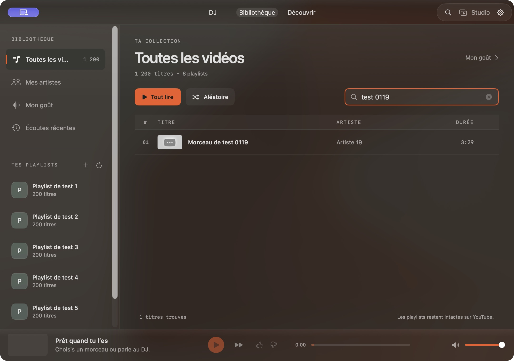
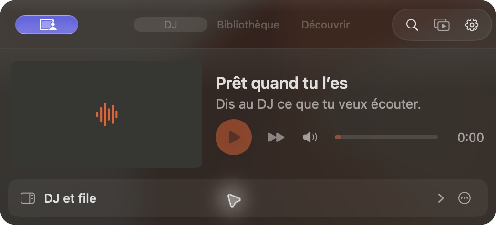
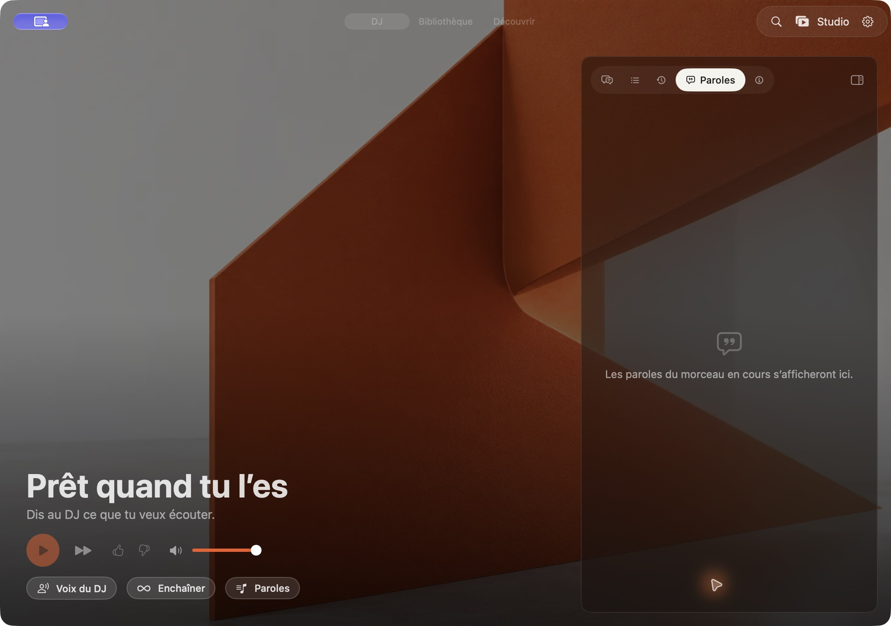

# Sillage — étude native macOS, performances et animations

Date : 29 octobre 2026. Base étudiée et utilisée pour les essais : `bc74b30` (`origin/main` au début de l’audit), app 1.13.1 (88). Cible du paquet : macOS 14, Swift tools 5.10. Environnement : macOS 27.2, Swift 6.4, Apple Silicon, Node 24.15.0. Les constats de lecture, les mesures et les observations sous automatisation sont distingués ci-dessous. Seuls le rapport et ses pièces de recherche sont ajoutés ; le code produit et l’app installée ne sont pas modifiés.

## Périmètre et méthode

Objectif : rendre Sillage plus réactif, plus sobre et plus cohérent avec macOS, en conservant son lecteur unique et ses modes Compact/Studio. Étude du code SwiftUI/AppKit/MediaPlayer/WebKit, vérification des API dans la documentation Apple et des disponibilités dans les interfaces du SDK installé. Aucun fichier de connexion privé lu ; aucune publication, connexion Google réelle ou dépense d’inférence requise pour cette étude.

Les priorités indiquent l’ordre conseillé des travaux, pas un gain mesuré. P1 : commencer par ce point avant d’ajouter des effets. P2 : amélioration ciblée à vérifier. P3 : piste facultative, sans motif de migration immédiate.

## Résultats des vérifications automatisées

| Vérification sur `bc74b30` | Résultat |
| --- | --- |
| `npm run verify:node` | Réussite : documentation API, frontières, types, 6 tests du contrôle d’architecture, 14 tests de l’évaluateur DJ, 307 tests serveur dans 28 fichiers, build serveur. |
| `npm run verify:macos`, environnement par défaut / SDK 27 | Échec de compilation : plugin `SwiftUIMacros.StateMacro` absent des Command Line Tools. Ce résultat ne démontre pas un défaut fonctionnel de l’app. |
| `SDKROOT=/Library/Developer/CommandLineTools/SDKs/MacOSX26.5.sdk SILLAGE_DATA_DIR=<temporaire> npm run verify:macos` | Réussite : 5 tests de packaging, compilation native (40,45 s au build initial SDK 26.5), scénarios SillageKit, moteur/lecteur, paroles, comptes, file, apparence, bureau, 5 contrôles micro sans capture matérielle, client serveur simulé et isolation des agents. Aucun réglage global du compilateur changé. |
| `python3 apps/macos/Checks/render-lyrics.py <sortie>` avec SDK 26.5 | Échec du script maintenu : le build SwiftPM par défaut produit maintenant `.build/out/Products/Debug`, tandis que le script attend `SillageMac.product/Objects.LinkFileList`. |
| Liaison manuelle des objets natifs pour le même `RenderLyrics.swift` | Un second défaut apparaît : retirer `SillageApp.swift.o` laisse `SillageApp.mainWindowID` non résolu. En remplaçant uniquement cette constante par un petit objet de test du même module, les six rendus de production sont générés et inspectés. Ce contournement local ne constitue pas une réussite du script maintenu. |

Les scénarios du noyau ne sont pas dénombrés comme des tests indépendants : leurs exécutables annoncent des groupes de contrôles. Les tests PostgreSQL sur base jetable et le smoke Docker ne font pas partie de cette exécution ; aucun SQL n’a été modifié. Les mises à jour de dépendances intégrées entre-temps dans `33c9813` sont séparées de l’audit ; la revalidation finale est indiquée en fin de document.

## Parcours observés et captures

Une copie de développement **Sillage Audit**, avec identifiant de bundle distinct, `SILLAGE_DATA_DIR` temporaire et sans schéma de retour Google, utilise un serveur local synthétique : 1 200 titres, six playlists, compte `audit@example.test`, aucun appel IA. Le raccourci global est désactivé dans cette copie pour ne pas prendre celui de l’app personnelle. Les jaquettes manquantes sont attendues avec ces identifiants fictifs. Les préférences de la copie, la bibliothèque et la session personnelles ne sont pas confondues.

1. **Bibliothèque et filtre** : les 1 200 titres sont comptés ; `test 0119` ramène le morceau 0119. La pagination par action d’accessibilité atteint ensuite les titres 0093–0099, au-delà de la première page de 50. Ce petit catalogue local ne simule ni la latence de production ni une charge serveur réelle. Captures [bibliothèque](assets/native-audit-2026-10-29/01-library.png), [filtre](assets/native-audit-2026-10-29/02-filter.png), [pagination](assets/native-audit-2026-10-29/11-library-pagination.png).
2. **Recherche globale au clavier** : après ouverture par ⌘F, l’arbre d’accessibilité conserve le focus sur le filtre précédent ; la saisie `x` y produit `test 0119x`. Un essai d’Échap efface le filtre sans fermer l’overlay. **À reconfirmer manuellement au premier plan** : l’outil signale ensuite `windowNotFoundAtPosition` pour un scroll physique ; les autres raccourcis ne sont donc pas considérés comme validés ou définitivement défectueux. Captures [overlay](assets/native-audit-2026-10-29/03-global-search.png), [saisie observée](assets/native-audit-2026-10-29/04-search-focus-bug.png).
3. **Réglages → Bureau** : accès par la barre d’outils, réglages de pastille, Dock et barre de menus visibles. Le bouton « Essayer » est invoqué sans ouvrir le micro ; la fluidité temporelle de la pastille et son comportement sur tous les Spaces ne sont pas validés par ces captures. [Capture Bureau](assets/native-audit-2026-10-29/05-desk-settings.png).
4. **Contenu du menu** : le mode QA présente le vrai `DeskMenu` dans une fenêtre ; « Ouvrir Sillage » retrouve la fenêtre principale. Cela ne valide pas la présentation du popover réel dans la barre système. [Capture du menu QA](assets/native-audit-2026-10-29/06-menu-preview.png).
5. **Compact et Studio** : replier le panneau réduit la fenêtre ; passer en Studio l’agrandit ; le bouton Paroles ouvre le panneau latéral avec son état vide. Aucune vidéo YouTube réelle ni bascule plein écran n’est testée ici. Captures [Compact ouvert](assets/native-audit-2026-10-29/07-compact-open.png), [replié](assets/native-audit-2026-10-29/08-compact-folded.png), [Studio](assets/native-audit-2026-10-29/09-studio.png), [Paroles](assets/native-audit-2026-10-29/10-studio-lyrics.png).
6. **Rendus des paroles** : six vues de production inspectées hors écran : synchronisées, texte simple, manquantes, en 320 et 380 points. Les longues lignes reviennent à la ligne, les contrôles de calage restent visibles ; aucune coupure majeure constatée sur ces fixtures. Voir les [rendus synchronisés](assets/native-audit-2026-10-29/lyrics/synced-320.png), [texte simple](assets/native-audit-2026-10-29/lyrics/plain-320.png) et [état manquant](assets/native-audit-2026-10-29/lyrics/missing-320.png), ainsi que leurs variantes `380` dans le même dossier.

## Mesures de processus et limites

Un [petit banc de mesure](assets/native-audit-2026-10-29/EngineAudit.swift) lié aux objets compilés de **SillageKit réel** injecte des backends synthétiques dans `PlaybackEngine`. Il ne remplace pas le code du moteur et ne mesure pas les `body` SwiftUI. Résultats bruts : [engine-measurements.json](assets/native-audit-2026-10-29/engine-measurements.json).

| Scénario | Résultat observé |
| --- | --- |
| 40 signaux identiques, position 10 s, pause | **40 notifications `objectWillChange`**, 40 signaux métier transmis. Les notifications sont inutiles pour l’affichage. |
| 100 positions progressives espacées de 0,1 s dans les données injectées | 33 notifications et 100 signaux métier transmis : le filtrage en lecture existe et conserve les signaux. Les échantillons sont injectés sans attendre ; ce n’est pas une cadence de rendu réelle. |
| Vrai `ClipPlayer` / AVPlayer, vidéo H.264 locale synthétique muette 720p/30, quatre secondes | Chargement au point 1,25 s en environ 103 ms ; après 650 ms de lecture, position 1,901 s ; seek demandé à 2,375 s, position observée 2,375 s ; arrêt retire l’item. Mesure ponctuelle, pas benchmark réseau ni garantie sur tous les codecs. |
| Copie debug au repos en Studio, panneau Paroles vide, compte local synthétique, relevé `ps` pendant 10,188 s | 0,03 s CPU, soit environ **0,29 % d’un cœur** ; RSS 181,28 → 181,38 Mio. Un seul processus et un court intervalle, autres apps actives ; aucun total WebKit/GPU ni mesure énergétique. [Mesure brute](assets/native-audit-2026-10-29/idle-measurements.json). |

Le relevé au repos est rassurant pour cet état vide, mais ne démontre pas l’absence de coût pendant la lecture ou une animation. Instruments (`xctrace`) n’est pas disponible : pas de fréquence réelle des réévaluations SwiftUI, de latence de trame, de 60/120 fps ou d’économie d’énergie affirmée. Les AirPods, AirPlay, VoiceOver, micro réel, veille/réveil et changement de sortie restent à tester matériellement.

## Points solides déjà présents

- **Un seul lecteur et une seule fenêtre principale.** `Window("Sillage", id: "main")` est cohérent avec cette intention ; `WindowGroup` permettrait au contraire plusieurs instances. Il n’y a pas de raison de le substituer par principe. Les réglages utilisent déjà `Settings`, et la barre de menus `MenuBarExtra` : [SillageApp.swift, lignes 133–181](../../apps/macos/Sources/SillageMac/SillageApp.swift#L133), [Apple — Windows](https://developer.apple.com/documentation/swiftui/windows).
- **Des commandes système existent.** `DeskNowPlaying` renseigne titre, artiste, durée, position, pochette et état de lecture, et branche lecture/pause/suivant/déplacement sur `MPRemoteCommandCenter`. Il évite déjà de republier les métadonnées à chaque tick en laissant macOS extrapoler le temps : [DeskNowPlaying.swift, lignes 18–60 et 69–103](../../apps/macos/Sources/SillageMac/DeskNowPlaying.swift#L18). Apple recommande ces mécanismes pour un lecteur personnalisé : [Handling external player events](https://developer.apple.com/documentation/mediaplayer/handling-external-player-events-notifications).
- **La pastille emploie le bon outil AppKit.** `NSPanel` avec `.nonactivatingPanel`, `canBecomeKey == false`, `canBecomeMain == false` exprime explicitement un affichage sans prise de focus : [DeskPill.swift, lignes 266–304](../../apps/macos/Sources/SillageMac/DeskPill.swift#L266), [Apple — nonactivatingPanel](https://developer.apple.com/documentation/appkit/nswindow/stylemask-swift.struct/nonactivatingpanel). Cela reste à vérifier à l’usage sur plusieurs écrans et Spaces.
- **Le noyau filtre déjà les événements de progression.** `DJModel.dispatch` ne notifie pas les vues du chat pour une simple progression sans effet métier : [DJModel.swift, lignes 284–290](../../apps/macos/Sources/SillageMac/DJModel.swift#L284). `DeskNowPlaying` et `StudioImmersion` contiennent aussi des gardes pour éviter des publications ou tâches permanentes inutiles.
- **L’accessibilité des animations est déjà largement prévue.** Transitions de navigation, passage entre lecteurs et pastille disposent de replis pour Réduire les animations. `StudioActivity` rétablit les boutons de fenêtre et retire ses observateurs au démontage : [MainView.swift, lignes 42 et 76–147](../../apps/macos/Sources/SillageMac/MainView.swift#L42), [Player.swift, lignes 313–335](../../apps/macos/Sources/SillageMac/Player.swift#L313), [StudioImmersion.swift, lignes 111–130](../../apps/macos/Sources/SillageMac/StudioImmersion.swift#L111).

## Constats et améliorations proposées

### P1 — Fiabiliser les outils de validation sur les SDK récents

Deux obstacles différents ont été rencontrés : le SDK 27 exige un plugin absent de cette installation CLT ; le script de rendu suppose un agencement d’objets SwiftPM qui n’est plus celui du build par défaut, puis retire une constante encore utilisée avec le point d’entrée de l’app. Sources : [package.json](../../package.json), [render-lyrics.py, lignes 14–29](../../apps/macos/Checks/render-lyrics.py#L14), [SillageApp.mainWindowID](../../apps/macos/Sources/SillageMac/SillageApp.swift#L25), et journaux de cette exécution.

Proposition : documenter une combinaison Xcode/SDK validée, rendre explicite le système de build du script de rendu et isoler l’identité de fenêtre du point d’entrée. Ne pas supprimer des macros ni réécrire les `@State` pour masquer l’absence d’un composant de l’outil. Le SDK 26.5 sert ici de récupération locale ; la validation SDK 27 reste à faire avec les outils complets.

### P1 — Limiter l’horloge aux vues qui affichent le temps

`Player` relaie tout `engine.objectWillChange`. Dans `MainView`, `ObservingPlayer` observe ensuite le lecteur entier et exécute la closure qui reconstruit `scene`. `Shell`, `DJView` et plusieurs contrôles observent aussi l’objet complet. Le seuil de progression du moteur est de 250 ms pendant la lecture ; il ne constitue pas une mesure de cadence réelle de toutes les vues. Cette structure relie néanmoins la composition globale à une donnée qui change très souvent : [Player.swift, lignes 12–34](../../apps/macos/Sources/SillageMac/Player.swift#L12), [MainView.swift, lignes 52–66 et 246–296](../../apps/macos/Sources/SillageMac/MainView.swift#L52), [PlaybackEngine.swift, lignes 313–320](../../apps/macos/Sources/SillageKit/PlaybackEngine.swift#L313).

Proposition : séparer l’état de présentation (`studio`, lecture, panne, type de lecteur) de la progression ; faire observer cette dernière uniquement par le curseur, le temps et les paroles. Dans `MainView`, ne suivre que ce qui change réellement la présentation. Conserver les signaux précis vers la préparation et l’enchaînement musical. Distinguer la réévaluation d’un `body` d’un redessin complet de l’écran : ce dernier n’est pas démontré ici.

Apple recommande de réduire les dépendances des vues et de les extraire en types distincts. `@Observable` peut limiter les dépendances aux propriétés lues, mais une migration exige d’examiner les relais Combine et les structures calculées existantes : [Demystify SwiftUI performance](https://developer.apple.com/videos/play/wwdc2023/10160/), [Migrating to Observation](https://developer.apple.com/documentation/swiftui/migrating-from-the-observable-object-protocol-to-the-observable-macro).

Validation proposée : compter les mises à jour de la fenêtre, du chat, des curseurs et des paroles pour lecture, pause et déplacement. La fenêtre et le chat ne devraient pas dépendre des seuls ticks de progression. Vérifier ensuite les changements de mode, pannes et fins de morceau.

### P2 — Éviter de publier des positions identiques en pause

Le lecteur web émet la progression toutes les 250 ms dès qu’il est prêt, sans condition de lecture. Dans le moteur, `|| !playing` provoque l’affectation de `elapsed` pour chaque signal reçu en pause, même si la valeur est identique : [player.assets.ts, ligne 34](../../apps/server/src/modules/player/player.assets.ts#L34), [PlaybackEngine.swift, ligne 318](../../apps/macos/Sources/SillageKit/PlaybackEngine.swift#L318).

Proposition : conserver le recalage précis de `PlaybackClock` et la transmission des signaux métier, mais ne publier `elapsed` que lorsque la position affichée change effectivement. Préserver les déplacements fins en pause ; ne pas remplacer ce cas par le seul seuil de 250 ms de lecture. Vérifier par un scénario significatif : plusieurs signaux identiques ne notifient pas les vues ; un seek en pause les notifie.

La mesure de cet audit confirme la notification sur chacun des 40 échantillons identiques injectés. Aucun gain CPU après correction n’est annoncé : aucune correction produit n’a été appliquée dans cette étude.

### P2 — Reconfirmer le focus clavier de la recherche globale

L’observation sous automatisation est reproductible dans la copie QA : après ⌘F, la saisie reste dans le filtre de bibliothèque au lieu du nouvel overlay. Le code possède pourtant déjà `@FocusState` et `.onAppear { focused = true }` : [GlobalSearch.swift, lignes 113–162](../../apps/macos/Sources/SillageMac/GlobalSearch.swift#L113). Il ne suffit donc pas de proposer d’ajouter un état de focus qui existe déjà.

Le ciblage physique de la fenêtre a ensuite échoué dans l’outil ; le focus de la fenêtre et les particularités de cette automatisation peuvent contribuer au résultat. Priorité de vérification manuelle : mettre Sillage au premier plan, cliquer le filtre, saisir une recherche, ⌘F, taper immédiatement, Échap, puis recommencer depuis le champ du DJ. Si confirmé, ajuster le transfert de focus après insertion effective de l’overlay et vérifier le retour au champ précédent. Ne pas généraliser cet essai à tous les raccourcis macOS.

### P2 — Isoler la saisie et les sections du DJ

`DJView` observe simultanément modèle DJ, lecteur, microphone, voix, historique, session et informations complémentaires. `composer`, `conversation`, `sessionPanel` et les mises en page sont des propriétés calculées du même type. `DJModel.prompt` est publié : une frappe peut donc invalider cette grande vue et d’autres abonnés au modèle DJ : [DJView.swift, lignes 6–36, 406–440 et 574–706](../../apps/macos/Sources/SillageMac/DJView.swift#L6), [DJModel.swift, lignes 16–28](../../apps/macos/Sources/SillageMac/DJModel.swift#L16).

Proposition : extraire le champ de saisie, le transport, le chat et chaque panneau en vrais types `View`, puis leur donner des dépendances plus étroites. Extraire les types sans réduire leurs abonnements ne suffirait pas. Ne pas masquer les changements en ajoutant aveuglément `Equatable` à des vues qui lisent des objets mutables. Mesurer le scénario de saisie pendant la lecture avant/après.

### P2 — Rendre la politique de mouvement uniforme

Le bouton de synchronisation de bibliothèque effectue une rotation infinie pendant `library.syncing` sans consulter `accessibilityReduceMotion` : [LibraryView.swift, lignes 92–99](../../apps/macos/Sources/SillageMac/LibraryView.swift#L92). C’est une incohérence par rapport aux autres surfaces qui prévoient déjà un mode réduit. Apple demande d’éviter les grands mouvements lorsque cette préférence est active : [accessibilityReduceMotion](https://developer.apple.com/documentation/swiftui/environmentvalues/accessibilityreducemotion).

Proposition : état occupé lisible, éventuellement un indicateur standard, sans rotation décorative dans le mode réduit. Vérifier également les changements de préférence pendant que la synchro tourne. Les animations de waveform représentent une information réelle ; elles ne doivent pas être supprimées indistinctement avec les effets décoratifs.

Les `TimelineView(.animation)` d’`EdgeGlow`, de `ShimmerText`, de `ThinkingDots` et de l’égaliseur respectent déjà le paramètre `still`/le mouvement réduit. Leur cadence par défaut peut néanmoins solliciter le rendu à haute fréquence pour de petits effets : [DeskPill.swift, lignes 495–579 et 723–742](../../apps/macos/Sources/SillageMac/DeskPill.swift#L495). Tester une cadence plafonnée pour les décorations et leur suspension quand la surface n’est pas visible. Ne pas appliquer cette limitation à la vidéo ni supposer qu’un écran 120 Hz nécessite 120 mises à jour par seconde de ces décorations.

### P2 — Découpler la chronologie des paroles et la liste

`TimelineView` à intervalle minimal de 0,1 s contient la géométrie, le défilement et les lignes des paroles ; le surlignage et le défilement automatique dépendent en pratique de l’index de ligne active : [LyricsView.swift, lignes 117–169](../../apps/macos/Sources/SillageMac/LyricsView.swift#L117).

Proposition : conserver une horloge commune précise, mais borner les entrées de la sous-vue de contenu aux changements de ligne et de calage. Garder l’identité du scroll et la suspension du suivi lors d’un défilement manuel. Vérifier les seeks, la pause/reprise, les lignes répétées et une correction de calage en cours de lecture.

### P2 — Vérifier sobriété et visibilité sans couper l’audio

Des cycles décoratifs peuvent être arrêtés lorsque leur surface n’est pas visible. `scenePhase` donne le cycle de vie de la scène, mais Apple précise qu’une scène macOS active n’est pas forcément au premier plan : [ScenePhase](https://developer.apple.com/documentation/swiftui/scenephase), [ScenePhase.active](https://developer.apple.com/documentation/swiftui/scenephase/active).

Proposition : utiliser visibilité/minimisation/occlusion et phase de scène selon le besoin, en distinguant rendu décoratif et lecture. Une fenêtre non focalisée n’est pas un motif de pause musicale. Le comportement actuel de fermeture est explicite : `SillageApp.onDisappear` annule le DJ et met la lecture en pause ; ne pas changer cette politique produit au cours d’une simple optimisation technique : [SillageApp.swift, lignes 152–155](../../apps/macos/Sources/SillageMac/SillageApp.swift#L152).

### P3 — Conserver les adaptateurs AppKit justifiés

`WindowSizer` protège le redimensionnement manuel et le plein écran, mémorise la taille de lecture et garde le bord supérieur de Compact. Ce comportement dépasse le seul placement initial d’une fenêtre : [MainView.swift, lignes 357–498](../../apps/macos/Sources/SillageMac/MainView.swift#L357). Les API SwiftUI plus récentes de taille idéale/placement sont utiles pour le zoom système, mais ne remplacent pas directement toute cette politique.

Les `updateNSView` de `WindowSizer`, `WindowAppearance` et `StudioActivity` replanifient du travail sur la file principale, même si le coordinateur refuse ensuite les valeurs identiques. D’abord réduire leurs invalidations en amont ; ensuite ne modifier ces ponts que si leur coût reste visible dans une trace. Le code possède déjà plusieurs gardes : [MainView.swift, lignes 339–401](../../apps/macos/Sources/SillageMac/MainView.swift#L339), [StudioImmersion.swift, lignes 76–80 et 111–119](../../apps/macos/Sources/SillageMac/StudioImmersion.swift#L76).

La pastille traverse les Spaces et le plein écran, n’active pas l’app et garde un placement personnalisé. `UtilityWindow` est une possibilité pour une palette secondaire standard, pas un remplacement établi pour cette pastille. Le raccourci Carbon existant gère appui et relâchement ainsi que les conflits système : [DeskHotKey.swift, lignes 23–65 et 77–90](../../apps/macos/Sources/SillageMac/DeskHotKey.swift#L23). Aucune API de remplacement n’est retenue sur la seule ancienneté de Carbon.

## Modernisation des API : possibilités et compatibilité

Les disponibilités ci-dessous ont été recoupées avec les annotations des interfaces SwiftUI/WebKit du SDK Apple installé (`MacOSX.sdk`). Elles ne changent pas la cible minimale du paquet.

| API / mécanisme | Disponibilité utile | Application à Sillage |
| --- | --- | --- |
| Observation (`@Observable`) | macOS 14 | Possible sans relever la cible ; commencer par les dépendances chaudes plutôt qu’une conversion générale. [Apple](https://developer.apple.com/documentation/swiftui/migrating-from-the-observable-object-protocol-to-the-observable-macro) |
| `windowIdealSize`, `windowIdealPlacement` | macOS 15 | Piste pour le zoom système ; repli macOS 14 et conservation de la politique Compact. [Apple](https://developer.apple.com/documentation/swiftui/scene/windowidealplacement(_:)) |
| `WindowVisibilityToggle`, `UtilityWindow` | macOS 15 | Utiles si un besoin de palette/fenêtre secondaire se présente ; pas nécessaires au lecteur unique. [Apple — Windows](https://developer.apple.com/documentation/swiftui/windows) |
| `sharedBackgroundVisibility` | macOS 26 | Déjà utilisé avec `#available(macOS 26, *)` dans `withoutSystemBackground()`. [StudioImmersion.swift, lignes 57–65](../../apps/macos/Sources/SillageMac/StudioImmersion.swift#L57), [Apple](https://developer.apple.com/documentation/swiftui/customizabletoolbarcontent/sharedbackgroundvisibility(_:)) |
| WebKit SwiftUI : `WebPage` / `WebView` | macOS 26 | Piste isolée à comparer au lecteur actuel ; ne pas migrer avant de vérifier le pont JavaScript, la lecture, le plein écran, AirPlay et le repli macOS 14. [Apple — WebKit for SwiftUI](https://developer.apple.com/documentation/webkit/webkit-for-swiftui), [Meet WebKit for SwiftUI](https://developer.apple.com/videos/play/wwdc2025/231/) |
| Nouvelle implémentation de `@State` par macro | SDK 27 ; comportement d’initialisation décrit comme rétroporté jusqu’aux OS d’Observation | Sujet de compatibilité de source et de construction des modèles ; ne pas cumuler valeur par défaut et initialisation personnalisée. Tester les initialisations lors d’une adoption ciblée. [Apple — What’s new in SwiftUI, WWDC26, 22:57–23:48](https://developer.apple.com/videos/play/wwdc2026/269/) |

Le lecteur actuel utilise déjà `WKWebView` non persistant, l’autorisation AirPlay, un pont limité à l’origine du lecteur et un conteneur AppKit pour son plein écran ; le clip téléchargé passe par `AVPlayer`/`AVPlayerView` : [Player.swift, lignes 129–174 et 313–366](../../apps/macos/Sources/SillageMac/Player.swift#L129). L’API la plus récente n’apporte pas à elle seule une preuve de gain de fluidité.

## Ordre de travail recommandé

1. Réparer les deux chemins de validation locale et disposer d’Instruments pour une mesure reproductible : lecture, pause, saisie pendant lecture, changement de panneau, ouverture/fermeture Compact, Studio et redimensionnement.
2. Réduire les notifications sans changement confirmées par le banc de mesure, puis isoler la progression et le champ de saisie. Garder les décisions musicales et la précision de l’horloge. Reconfirmer le point de focus clavier au premier plan.
3. Uniformiser Réduire les animations et borner les effets décoratifs ; vérifier mouvement réduit, transparence réduite et clavier.
4. Valider l’intégration système avec une vraie lecture : commandes multimédias et centre de contrôle, volume, écouteurs, veille/réveil, sortie audio, fermeture/réouverture, plein écran et écran externe.
5. N’adopter des API macOS 15/26/27 qu’en réponse à un besoin démontré et avec les replis nécessaires. Aucune refonte visuelle ni ajout d’effet Liquid Glass n’est requis par cette étude.

## Recette complémentaire avant de conclure

- SwiftUI Instruments : nombre et durée des mises à jour de `MainView`, `DJView`, du chat, des paroles et des ponts AppKit ; mesurer aussi le processus WebKit.
- Accessibilité : parcours réel au clavier et VoiceOver, changements de réglages pendant l’exécution ; une lecture de code/capture ne valide pas la conformité globale. [Apple — Accessibility fundamentals](https://developer.apple.com/documentation/swiftui/accessibility-fundamentals).
- Fenêtres : restauration taille/position, zoom, redimensionnement manuel, minimisation, retour du Dock/menu, Stage Manager et plusieurs Spaces/écrans. Ne pas limiter cette recette à `scenePhase`.
- Lecture : seek en pause et lecture, bascule YouTube/clip, panne et repli, variation de qualité, veille/réveil, changement de sortie, centre de contrôle et touches multimédias.
- Comptes : retours tardifs après déconnexion/changement de compte dans un environnement dédié, sans utiliser une session personnelle pour obtenir une simple capture.

## Conclusion de recherche

La modernisation utile commence par des frontières d’observation plus étroites, des validations locales fiables et une politique de mouvement cohérente. Les principaux composants natifs sont déjà en place. Les tests réussissent avec le SDK 26.5 ; le banc de mesure confirme les notifications inutiles en pause, et la vidéo locale confirme lecture et seek natifs. Il s’agit d’un audit avec preuves, pas d’une version optimisée livrée ni d’un benchmark avant/après. L’app personnelle est conservée.

## Revalidation avant intégration

La branche de recherche a été rebasée sur `33c9813` après la mise à jour des dépendances. Les dépendances ont été réinstallées, puis `npm run verify:node` et `SDKROOT=/Library/Developer/CommandLineTools/SDKs/MacOSX26.5.sdk SILLAGE_DATA_DIR=<temporaire> npm run verify:macos` ont réussi de nouveau. Les constats et captures portent sur le code Mac de `bc74b30`, inchangé par cette mise à jour. L’intégration ajoute uniquement cette recherche, les captures synthétiques et le banc de mesure ; aucun correctif produit ni nouvelle version distribuée.
